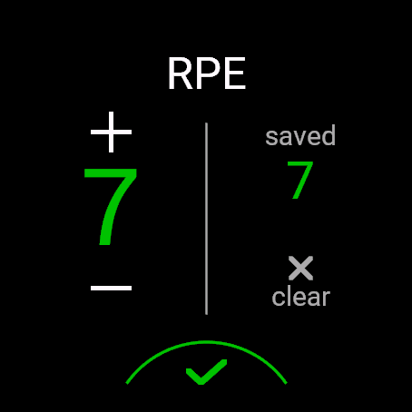
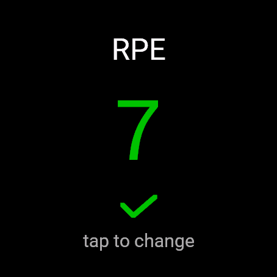
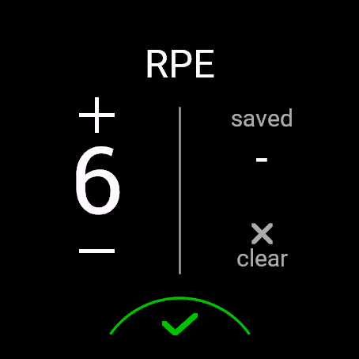
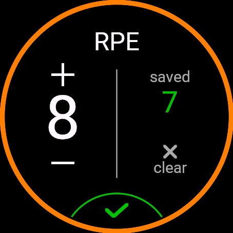
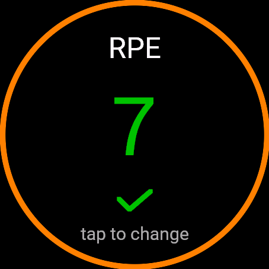

# Set RPE

Rate how hard each set felt (RPE 1–10, the same scale as the watch's own rating at the end of a workout), not just the whole workout, right inside the watch's Strength activity. Each value is saved with its set in the activity file, ready for analysing effort per exercise over time. Designed to blend in with the watch's own edit screens.

> Status: in development, not yet in the Connect IQ Store.

<p>
  
  
</p>

## Setup
> **Rating needs the field on its own data screen (full screen).** On a screen with several fields it shows the saved value but deliberately ignores taps, so nothing is changed by accident.

Add Set RPE to the Strength activity on its own data screen, as the only field. Set RPE is only offered for the Strength activity. Tested on the Venu 3; the Venu 3S is supported but not tested on a device.

Languages: English, German, Finnish, Swedish, Danish.

## Rating a set
- Use **+ / −** to pick the value. It starts at your last value, because consecutive sets are usually rated similarly, and stops at 1 and 10.
- Tap the **green check mark** at the bottom to save. The editor closes and shows the saved value; tap anywhere to change it.
- **clear** removes the value of the current set.
- Rate during the set or in the rest after it. A value given in the rest replaces the one from the set.
- An **orange ring** around the edge means you are in a rest. No ring: a set, or the warm-up.
- The watch's own reps/weight screen after a set still works as usual; swipe back to Set RPE to rate.

<p>
  
  
  
</p>

## Which set does a value belong to?
- To the set you are in, or – during a rest – to the set **right before** that rest.
- Each new set starts without a value. Not rated means no value (not 0).
- **Left/right exercises:** the watch counts left and right as two sets. With "left, right, rest" the rest belongs to the **right** side, so rate the left side while doing it, or right after it, before you press the button for the right side.

## What it can't do
- It can't end a set or a rest; that stays with the watch's button.
- It doesn't vibrate when saving, like the watch's own reps/weight screen; the screen change is the confirmation.
- It only works in the Strength activity.

## Where the data goes
The values are stored in the activity file on the watch, which the watch syncs to your own Garmin Connect account like the rest of the activity. Garmin Connect shows them as a chart ("RPE per set"). Nothing is sent to the developer. See the [privacy page](privacy.md).

## For developers: reading the values from the FIT file
Set RPE writes two [developer fields](https://developer.garmin.com/fit/cookbook/developer-data/) into every `record` message of the activity:

| Field | Type | Meaning |
|---|---|---|
| `set_rpe` | uint8 | Saved RPE 1–10 of the current set. 255 (FIT's invalid value, read as `None`) = no value |
| `set_rpe_index` | uint16 | Index of the current `set` message (number of set/rest changes since the start) |

How to assign the values to sets:
- Match by field **name**, not by the app ID in `developer_data_id`: test builds write a different ID than the store version.
- Assign each record to the `set` message with index `set_rpe_index`. Don't rely on time alone: `set_rpe_index` moves about 1 s *after* a set/rest change, so the record written right at a set's `start_time` still belongs to the previous set (it holds a value saved just before the change).
- The RPE of an active set is the last non-empty `set_rpe` in that set and in the rest set(s) directly after it.
- Use time (the latest `start_time` ≤ record time) as a cross-check. If the set list was edited in Garmin Connect, the positions no longer match.

Example with Python and [fitdecode](https://pypi.org/project/fitdecode/):

```python
import fitdecode

with fitdecode.FitReader("activity.fit") as fit:
    for frame in fit:
        if isinstance(frame, fitdecode.FitDataMessage) and frame.name == "record" \
                and frame.has_field("set_rpe"):
            print(frame.get_value("timestamp"), frame.get_value("set_rpe"), frame.get_value("set_rpe_index"))
```

> The field layout may still change before version 1.0.

## Support
[Open an issue](https://github.com/sebkraemer/connect-iq/issues/new?template=set-rpe.md) or write to connect-iq@sk.mozmail.com.
