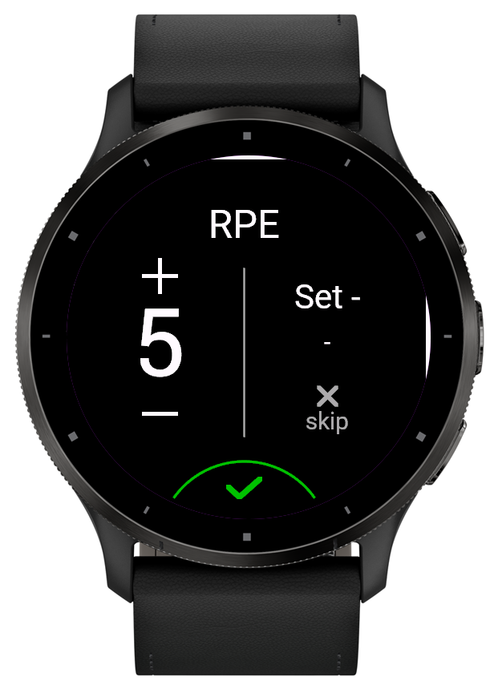

# Set RPE

Rate the perceived exertion (RPE 1–10) of every set, not just the whole workout, right inside the watch's Strength activity. Each value is stored with its set in the activity file, ready for analysing effort per exercise over time. Designed to blend in with the watch's own edit screens.

> Status: in development, not yet in the Connect IQ Store.



## How to use
1. Install Set RPE from the Connect IQ Store and add it to the Strength activity, on its own data screen with one field.
2. Start the activity. After a set, swipe to the Set RPE screen.
3. Use **+** / **−** to pick a value and tap the green check to apply it. Tap **skip** to leave the set unrated.
4. The value belongs to the set shown on the screen and is reset at the next set.

## Where the data goes
The values are stored in the activity's FIT file and shown as a chart in Garmin Connect. See the [privacy page](privacy.md).

## For developers: reading the values from the FIT file
Set RPE writes two [developer fields](https://developer.garmin.com/fit/cookbook/developer-data/) into every `record` message of the activity:

| Field | Type | Meaning |
|---|---|---|
| `set_rpe` | uint8 | Applied RPE 1–10. 255 (FIT's invalid value, read as `None`) = no value yet, reset at each set/rest change, or skipped |
| `set_rpe_pos` | uint16 | Counts set/rest changes since the start = index of the activity's `set` message |

Rule of thumb: the RPE of a set is the **last** value applied between the start of that set and the start of the next set (values applied during the rest after a set belong to that set). Match records to sets by time (`set.start_time`), `set_rpe_pos` is a cross-check.

Please match by **field name**, not by the app ID in `developer_data_id`: test builds write a different ID than the store version.

Example with Python and [fitdecode](https://pypi.org/project/fitdecode/):

```python
import fitdecode

with fitdecode.FitReader("activity.fit") as fit:
    for frame in fit:
        if isinstance(frame, fitdecode.FitDataMessage) and frame.name == "record" \
                and frame.has_field("set_rpe"):
            print(frame.get_value("timestamp"), frame.get_value("set_rpe"), frame.get_value("set_rpe_pos"))
```

> The field layout may still change before version 1.0.

## Limits
- Strength activity only.
- Supported devices: Venu 3, Venu 3S (tested on Venu 3).
- Works as a full-screen data field (one field on the data screen).

## Support
[Open an issue](https://github.com/sebkraemer/connect-iq/issues/new?template=set-rpe.md) or write to connect-iq@sk.mozmail.com.
